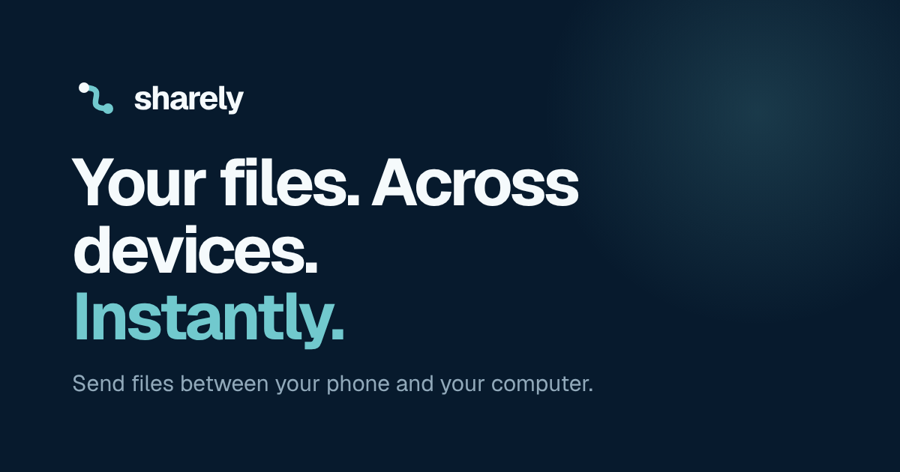

# Sharely website



The public website for [Sharely](https://github.com/SatyamChy03/Sharely), an app that sends files, photos, text and links between a phone and a laptop over local Wi-Fi.

The site explains what Sharely does, offers the desktop and Android builds for download, and walks a new user from download to their first transfer.

> **Status:** the site is complete, but the app has no published release yet. Until one exists, every build is shown as "Not yet available" and the download buttons are disabled. They switch on by themselves after the first release (see [How downloads work](#how-downloads-work)).

## Contents

- [Pages](#pages)
- [Platforms](#platforms)
- [Tech stack](#tech-stack)
- [Getting started](#getting-started)
- [Commands](#commands)
- [How downloads work](#how-downloads-work)
- [Configuration](#configuration)
- [Project structure](#project-structure)
- [Design](#design)
- [Accessibility](#accessibility)
- [Deployment](#deployment)
- [After an app release](#after-an-app-release)
- [Credits](#credits)

## Pages

| Path | Page | What it holds |
|---|---|---|
| `/` | Home | Hero with an animated laptop-and-phone picture, supported platforms, features, a three-step "how it works", an app showcase with four views, privacy and control, a call to action, and the FAQ |
| `/download` | Download center | Operating-system picker, installer formats, version, size, release date, the download button, and a SHA-256 checksum with the command to verify it |
| `/install` | Installation guide | Step-by-step setup per operating system: download, install, first launch, pairing the phone, sending a first file, and troubleshooting |
| anything else | Not found | A 404 page with links back to Home and Downloads |

The site preselects the visitor's operating system from the browser, remembers a manual choice, and accepts `?os=windows`, `?os=linux` or `?os=macos` on the download and install pages. A visitor on a phone is told that the desktop app is installed on the computer first.

## Platforms

| Platform | Format | State on the site |
|---|---|---|
| Windows 10 or later (64-bit) | Portable app, `.zip` | Offered as soon as a release contains it |
| Linux (64-bit, Ubuntu 22.04 or newer) | Debian package, `.deb` | Offered as soon as a release contains it |
| Linux (64-bit, other distributions) | Portable archive, `.tar.gz` | Offered as soon as a release contains it |
| Android 8 or later | `.apk` | Offered as soon as a release contains it |
| macOS | Disk image, `.dmg` | Planned; shown as "Not yet available" |

## Tech stack

| Part | Choice |
|---|---|
| Build tool | [Vite](https://vite.dev) 8 |
| UI | [React](https://react.dev) 19 with TypeScript (strict mode) |
| Routing | [React Router](https://reactrouter.com) 7, with the download, install and 404 pages loaded on demand |
| Styling | [Tailwind CSS](https://tailwindcss.com) 4, with the Sharely colour, radius and motion tokens defined in `src/index.css` |
| Icons | [Lucide](https://lucide.dev) for interface icons; platform logos are inline SVG paths |
| Fonts | Geist and Geist Mono, bundled with the site through Fontsource |

The built site is static files only. It has no backend, no analytics and no cookies, and it loads nothing from third-party servers. The only stored value is the visitor's chosen operating system, kept in the browser's local storage.

## Getting started

You need [Node.js](https://nodejs.org) 22 or newer and npm.

```bash
git clone git@github.com:SatyamChy03/Sharely-web.git
cd Sharely-web
npm install
npm run dev
```

The site is then served at `http://localhost:5173` and reloads as you edit.

## Commands

| Command | What it does |
|---|---|
| `npm run dev` | Starts the local development server |
| `npm run build` | Refreshes the release data, type-checks, builds into `dist/`, and writes `dist/404.html` |
| `npm run preview` | Serves the built `dist/` folder locally |
| `npm run sync-release` | Refreshes `src/config/release.json` from GitHub without building |

`npm run build` fails on any TypeScript error, so a successful build is also a passed type-check.

## How downloads work

The site never hard-codes a download link. Instead:

1. `scripts/sync-release.mjs` asks the GitHub API for the releases of the app repository (`SatyamChy03/Sharely`).
2. It takes the newest release that is not a draft and contains at least one known file. Pre-releases count.
3. It writes the version, date, release-notes link, and each file's name, address, size and SHA-256 checksum to `src/config/release.json`.
4. The pages read that file at build time.

The script runs automatically before every build. Files are recognised by the names the app's release workflow gives them:

| Download | File name | Key in `release.json` |
|---|---|---|
| Windows | `sharely-<tag>-windows.zip` | `windowsZip` |
| Linux, Debian package | `sharely-<tag>-linux-amd64.deb` | `linuxDeb` |
| Linux, portable | `sharely-<tag>-linux-x64.tar.gz` | `linuxTar` |
| Android | `sharely-<tag>-android.apk` | `androidApk` |

Checksums come from the release's `SHA256SUMS.txt`, or from the digest GitHub reports for the file when that list is missing.

Behaviour in the edge cases:

- **No release yet:** `release.json` holds empty values, every platform shows "Not yet available", and the buttons are disabled with an explanation next to them.
- **A release with only some files:** only those platforms are offered; the rest stay "Not yet available".
- **A pre-release:** the download card adds a note that the build is not code-signed and points to the checksum.
- **GitHub cannot be reached during a build:** the script prints a warning and keeps the existing `release.json`, so the build still succeeds with the last known data.

Only links that start with `https://github.com/SatyamChy03/Sharely/releases/download/` are accepted, so a release cannot point the site's buttons anywhere else.

### Adding macOS later

1. Make the app's release workflow publish a file such as `sharely-<tag>-macos.dmg`.
2. Add `macosDmg: '-macos.dmg'` to `ASSET_SUFFIXES` in `scripts/sync-release.mjs`.
3. Add `'macosDmg'` to `ReleaseAssetKey` in `src/config/release.ts`.
4. Pass `'macosDmg'` as the second argument of the macOS format in `src/config/platforms.ts`.

The macOS installation steps are already written in `src/pages/install/guides.ts`.

## Configuration

### Content

Everything the site says about the product lives in a few files, so wording can change without touching the page code.

| What | File |
|---|---|
| Platforms, installer formats, system requirements | `src/config/platforms.ts` |
| Site name, tagline, GitHub link, privacy, terms and support links | `src/config/site.ts` |
| Claims about the app: pricing, network needs, how transfers work, save folder, updates | `src/config/facts.ts` |
| Installation steps per operating system | `src/pages/install/guides.ts` |
| Pairing, first-file and common troubleshooting steps | `src/pages/install/sharedSections.ts` |
| FAQ questions and answers | `src/sections/faqItems.ts` |
| Page titles and descriptions | `src/config/site.ts` (`pageMeta`) |

A `null` value in `site.ts` or `facts.ts` is deliberate. The site then shows a neutral answer ("soon", "to be announced") instead of a claim. Fill a value in only once it is true of the released app.

### Environment variables

All are optional and read at build time.

| Variable | Purpose | Default |
|---|---|---|
| `VITE_SITE_URL` | The public address, used for canonical and social-sharing links | The address the page is opened from |
| `VITE_BASE` | The sub-path when the site is not served from the root, for example `/Sharely-web/` | `/` |
| `GITHUB_TOKEN` | Raises the GitHub API limit for `sync-release`, useful in CI | none |
| `SHARELY_REPO` | The repository releases are read from | `SatyamChy03/Sharely` |

## Project structure

```
.
├── index.html                  # page shell and default sharing tags
├── public/                     # favicon and social-sharing image
├── scripts/
│   ├── sync-release.mjs        # writes src/config/release.json from GitHub
│   └── spa-fallback.mjs        # copies index.html to 404.html after a build
└── src/
    ├── main.tsx                # entry point: fonts, styles, React root
    ├── App.tsx                 # routes
    ├── index.css               # Tailwind theme: colours, radii, motion
    ├── config/                 # site details, platforms, product facts, release data
    ├── lib/                    # platform detection, selected-platform state, page meta, formatting
    ├── components/
    │   ├── ui/                 # Button, Badge, Card, Container, headings, copy button
    │   ├── layout/             # header, footer, page layout, scroll handling, error boundary
    │   ├── mock/               # the laptop and phone app screens drawn on the home page
    │   └── *.tsx               # logo, platform icons, file thumbnails, download button
    ├── sections/               # the sections of the home page
    └── pages/
        ├── Home.tsx
        ├── Download.tsx        # with its parts in pages/download/
        ├── Install.tsx         # with its parts in pages/install/
        └── NotFound.tsx
```

## Design

The site uses the same visual system as the app: one dark appearance, with depth shown by tone instead of shadow.

| Token | Value | Used for |
|---|---|---|
| `ink` | `#071A2D` | Page background |
| `ink-deep` | `#051425` | Alternating sections, footer |
| `surface` | `#0D2742` | Cards |
| `elevated` | `#123556` | Hover, selected, secondary buttons |
| `line` / `line-strong` | `#1B3F63` / `#24507A` | Borders |
| `cyan` | `#71C9CE` | The primary action, connection state, progress, selection |
| `aqua` | `#A6E3E9` | Code and soft accents |
| `fg` / `muted` | `#F5FAFC` / `#91A9BA` | Text and secondary text |
| `success` / `danger` | `#52D273` / `#FF647C` | Status |

Radii are 20 px for cards, 16 px for zones, 10 px for buttons and 6 px for badges. Headings use Geist at weight 700 with tight letter-spacing; numbers, sizes, codes and commands use Geist Mono. Motion uses one easing curve, `cubic-bezier(0.2, 0.8, 0.2, 1)`.

The app screens on the home page are drawn in code at a fixed size and scaled to fit, so they stay sharp at any width and need no image files.

## Accessibility

- A "Skip to content" link is the first focusable element on every page.
- All controls are real buttons and links with a visible focus ring.
- The platform picker, format picker and tab bars follow the radio-group and tab patterns, with arrow-key navigation.
- Status is never shown by colour alone: badges pair a filled or hollow dot with a word.
- Decorative pictures are hidden from screen readers; each app mock-up has one text description.
- With "reduce motion" switched on in the system, the animations and smooth scrolling are turned off.
- A disabled download button points to the text that explains why it is disabled.

## Deployment

`npm run build` produces a static site in `dist/` that any static host can serve.

The site uses clean addresses (`/download`, `/install`), so the host must return the app for paths it does not know. The build writes `dist/404.html` as a copy of `index.html` for hosts that serve that file for unknown paths, such as GitHub Pages. On other hosts, add a rule that rewrites every path to `/index.html`.

When the site is served from a sub-path, for example `https://<user>.github.io/Sharely-web/`, build with the base set:

```bash
VITE_BASE=/Sharely-web/ VITE_SITE_URL=https://<user>.github.io/Sharely-web npm run build
```

## After an app release

1. Publish the release in the app repository by pushing a `v*.*.*` tag.
2. Wait for its release workflow to attach the files and `SHA256SUMS.txt`.
3. Rebuild and redeploy this site. `npm run build` picks up the new release by itself.
4. Open `/download` and confirm the version, sizes and checksums are shown.

To keep the release data in the repository up to date as well, run `npm run sync-release` and commit the changed `src/config/release.json`.

## Credits

- [Geist and Geist Mono](https://vercel.com/font) fonts, SIL Open Font License 1.1.
- [Lucide](https://lucide.dev) icons, ISC License.
- Android, Apple and Linux logo paths from [Simple Icons](https://simpleicons.org). The logos are trademarks of their owners and are used only to name the platforms.
